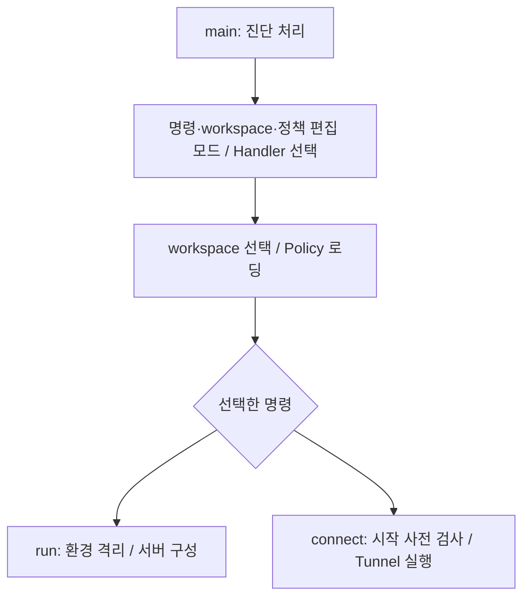

# 실행 흐름과 연결 원리

[개발 규약](conventions.md)이 배치·호출 경계의 유지 기준을,
[설정과 운영 계약](configuration.md)이 사용자 값·권한·시작·종료·진단·정리 보장을 소유한다.
이 문서는 여러 module이 연결되는 방식과 그 이유를 설명한다.

## CLI에서 서버로

[`app/cli.py`](../src/local_dev_mcp/app/cli.py)의 명령·workspace·정책 편집 플래그 해석은 설정 로딩보다 먼저다.
설정이 없는 디렉터리에서도 help와 사용 오류를 처리하기 위해서다.

[`app/workspace.py`](../src/local_dev_mcp/app/workspace.py)는 CLI와 사전 검사가 공유하는 시작 경로 선택을 맡는다.
선택한 경로는 `Policy.load()`가 절대 경로로 고정하며, 이후 조립과 도구는 서버별 Policy를 전달받는다.
호출 위치와 작업 대상을 구분해 설치 경로나 현재 디렉터리를 암묵적인 작업 기준으로 재사용하지 않는다.
옵션의 기본값·상대 경로·설정 탐색 계약은 [Workspace 선택](configuration.md#workspace-선택)에 있다.

`run`은 최소 환경으로 교체하고 FastMCP의 자동 dotenv 읽기를 끈 뒤 서버를 import한다.
라이브러리의 import 시점 로딩이 애플리케이션의 명시적 설정 읽기보다 먼저 실행되지 않게 하기 위해서다.
[`ServerSettings.load()`](../src/local_dev_mcp/app/runtime.py)는 시작 snapshot을 만들고,
[`create_server()`](../src/local_dev_mcp/mcp/server.py)는 수동 정의 목록과 서버별 실행 객체를 등록한다.
준비값과 안전한 준비 오류를 구분해 등록·터미널 경고·상태 조회·호출 거부가 같은 snapshot을 사용한다.
설정의 적용 시점과 시작 오류 조건은 [시작 snapshot](configuration.md#시작-snapshot)을 따른다.

`app`은 시작 조립을, `mcp.server`는 서버 조립을, `mcp.registry`는 기능이 공유하는 등록·호출 interface를 소유한다.
기능이 interface를 import할 때 서버 조립까지 로딩하지 않도록 두 package init은 가볍게 유지한다.
공통 설정·준비 결과 타입은 루트에 남기고, 기능에서 시작 조립으로 필요한 타입 의존은 type-only로 둔다.
전체 도구의 준비 상태 조회는 [`tools/get_tool_readiness.py`](../src/local_dev_mcp/tools/get_tool_readiness.py)가 소유한다.
파일 기능과 별도 도구이며 공유 준비 결과의 값 계약은 루트 `readiness.py`를 사용한다.

## MCP에서 작업으로

호출 순서와 내부 조합의 규칙은 [공통 호출 경계](conventions.md#도구-정의와-호출-경계)에 있다.
[`mcp/registry.py`](../src/local_dev_mcp/mcp/registry.py)의 권한 middleware를 통과하면
같은 middleware가 시작 snapshot의 도구별 준비 상태도 확인한다.
준비 부족이 입력과 무관한 고정 정보이므로 strict 검증·동적 GPG 준비 전에 거부할 수 있다.
그다음 FastMCP가 원본 인자의 strict 검증과 dependency 준비를 수행하고 본문을 호출한다.

commit의 연결 함수는 공개 message와 Depends 준비값을 받아 일반 Python 본문에 전달한다.
provider는 시작 설정을 다시 읽지 않고 필요한 동적 GPG 상태를 확인한다.
공백뿐인 메시지 등 본문에서 수행하는 의미 검증까지 dependency보다 먼저인 것은 아니다.
내부 Python 조합은 준비값을 명시적으로 전달하고 공통 Git 실행의 정책 검사도 거친다.
등록 CLI 작업은 입력 검증 후 선택한 recipe의 논리 권한과 준비 상태를 확인한다.
서로 다른 recipe의 명령 요구를 합쳐 전체 작업 도구를 비활성화하지 않는다.

FastMCP는 schema·구조화 결과·transport를 처리하며 애플리케이션은 Policy·Git 의미·안전한 진단을 처리한다.
`SafeToolDiagnostics`는 검증 실패를 필드·오류 종류·수정 안내로 바꾸고 거부한 값이나 임의 필드명을 반복하지 않는다.
`safe_execution`은 예상하지 못한 provider·본문 예외가 SDK 원문 logger에 도달하기 전에 안전하게 변환한다.
응답 masking만으로는 SDK 내부 로그에 포함될 원래 예외를 제거할 수 없기 때문이다.
출력 형식과 도구 오류·CLI 종료의 구분은 [운영 진단 계약](configuration.md#진단-출력)을 따른다.

Git은 facade → 명령 함수 → 실행 지원으로 작업을 진행한다.
실제 경로·symlink·저장소 상태는 작업 계층에서 확인하며 schema 검증만으로 대신할 수 없다.
HEAD의 누적 시간 예산과 쓰기·후속 관측의 의미는 [Git 계약](tools/git/README.md)이 소유한다.

## 파일 접근과 원문 관측

파일 도구는 서버 설정에 결합한 workspace module을 공유한다. blocking 파일 작업은 라이브러리 worker에서 수행하고,
탐색·읽기·수정의 협력적 예산 확인 지점에서 취소를 전달한다. 입력 검증 뒤에도 실제 접근 직전 경로를 확인한다.
Git entry의 의미와 일반 파일 읽기의 symlink 의미가 다르므로 Git 조합을 범용 파일 접근으로 재사용하지 않는다.

원본 바이트의 해시와 반환 구간은 한 읽기에서 얻는다. 읽은 구간만 서버 메모리에 보관해 이후 요청에서
긴 원문을 다시 생성하지 않고 참조할 수 있는 근거를 만든다. 수정은 이 근거와 현재 전체 파일 버전의 일치를 요구한다.
서버 lifespan 종료 시 보관을 비우며 요청 한정 Context state나 불안정한 연결 식별자에 보관 수명을 맡기지 않는다.
서버·workspace 결합은 인증된 Chat 구분이 아니다. 수명·한계는 [Workspace 계약](tools/workspace/README.md)이 소유한다.

[`_text.py`](../src/local_dev_mcp/tools/workspace/_text.py)는 byte chunk의 UTF-8 해석·줄 분리·해시를 처리한다.
[`_reads.py`](../src/local_dev_mcp/tools/workspace/_reads.py)는 실제 파일 접근·예산·취소·동일성 관측을 소유한다.
데이터 변환을 OS 관측과 분리해 chunk 경계의 계약을 독립적으로 검사하면서 실제 접근과 결과 발행의 검증도 유지한다.
관측한 원문의 보관·만료·퇴출은 [`_read_refs.py`](../src/local_dev_mcp/tools/workspace/_read_refs.py)가 소유한다.
`WorkspaceFiles`는 전체 관측이 성공한 뒤에만 보관을 발행하고 서버 종료 시 비운다.

[`_edits.py`](../src/local_dev_mcp/tools/workspace/_edits.py)는 관측 구간의 원문 일치와 바이트 교체를 순수 데이터로 처리한다.
[`_writes.py`](../src/local_dev_mcp/tools/workspace/_writes.py)는 동일 파일 수정의 직렬화·현재 버전 재확인·임시 파일 준비와 교체를 맡는다.
교체와 후속 관측을 분리해 관측 실패가 이미 일어난 쓰기를 무변경으로 바꾸지 않도록 한다.
새 참조는 교체 결과를 실제로 재관측한 뒤 발행하며, 충돌 시에는 현재 파일을 다시 읽어 재개하게 한다.
구체적인 결과·복구 안내는 [수정 계약](tools/workspace/README.md#관측-구간-수정과-연속-호출)에 있다.

[`_mutations.py`](../src/local_dev_mcp/tools/workspace/_mutations.py)는 없는 파일 생성과 버전 확인 뒤의 단일 파일 삭제를 맡는다.
기존 경로 잠금·원문 관측·접근 정책을 공유하며, 생성은 완성된 내용의 덮어쓰기 없는 게시와 필요한 부모 경로를 확인한다.
생성·삭제의 요청 장부는 원문 참조와 별개다. 입력 지문과 적용 결과를 결합해 응답 유실 뒤 같은 요청이 파일 작업을 반복하지 않게 한다.
장부는 현재 파일 snapshot이나 삭제 원본 백업이 아니며, 현재 파일이 바뀌어도 이전 receipt 조회를 먼저 수행한다.
구체적인 수명·상한·부분 적용·영구 삭제 의미는 [변경 계약](tools/workspace/README.md#파일-생성삭제와-요청-재전송)이 소유한다.

파일 도구와 Git 공개 결과는 같은 Policy의 경로별 접근 판단을 사용한다.
Git diff는 변경 경로를 먼저 확인하고 허용된 파일만 patch 입력에 넣어, 보호 파일 내용을 받은 뒤 마스킹하는 흐름을 피한다.
필터링한 전체 조회에는 불완전함을 명시한다. 내부 설정·ignore 규칙의 소비 권한은 agent의 원문 조회 권한과 구분한다.

공개 반환 타입에서 output schema를 만들고 registry의 결과 처리에서 중복된 전체 TextContent를 짧은 안내로 바꾼다.
파일 결과와 Git 결과의 기존 출력을 동시에 변경하지 않도록 정의에 명시한 도구에만 적용한다.

## 등록 CLI 작업

[`tools/tasks`](../src/local_dev_mcp/tools/tasks/__init__.py)는 이름 있는 recipe의 실행·조회·취소와 서버별 보관 수명을 소유한다.
설정 로딩은 recipe 값과 공통 환경을 고정하고, 작업 manager는 개별 권한·실행 파일의 준비 결과를 만든다.
사용자가 선택한 상대 테스트 대상을 고정 argv 뒤에 추가하며 shell 문자열을 조합하거나 임의 옵션을 받지 않는다.

프로젝트 공통 환경 조립은 [`app/_task_environment.py`](../src/local_dev_mcp/app/_task_environment.py)가 맡는다.
서버 credential을 작업에 전달할지와 결과에서 비밀값을 감출지는 다른 책임이므로,
[`redaction.py`](../src/local_dev_mcp/redaction.py)의 catalog는 주입 환경 목록에서 역산하지 않는다.
청크 수집 시 알려진 비공개 값과 유한한 변형을 처리하고, 보호를 수행할 수 없으면 원문 대신 보류 이유를 남긴다.
이 처리는 CLI 작업 진단의 계약이며 파일 도구의 정확한 원문 관측을 일반 마스킹 결과로 바꾸지 않는다.

짧은 대기 후 반환하는 job은 애플리케이션 수명에 속한다. 같은 request ID의 재제출은 기존 실행 조회로 연결하며,
서버 lifespan 종료 때 실행 중인 작업을 취소하고 직접 프로세스 정리를 기다린다.
수집·redaction과 응답 표시를 분리해 기본 시작·조회·취소 응답은 metadata만 반환한다.
명시적인 `include_output=true` 조회만 같은 job에 보관된 진단을 포함하므로 polling마다 긴 출력을 반복하지 않는다.
보관 상한·상태·응답 유실 후 행동은 [작업 계약](tools/tasks/README.md)이 소유한다.

## Tunnel 연결

[`tools/tunnel_client`](../src/local_dev_mcp/tools/tunnel_client)의 실행 순서는 다음과 같다.

1. tunnel-client 권한·실행 파일과 선택한 workspace의 .env에 있는 Tunnel 값을 검증한다.
2. 별도 Python 프로세스의 `_preflight.py`에 절대 workspace 경로와 정책 편집 모드를 전달해 MCP 정적 시작 설정을 검사한다.
3. 사전 검사의 안전한 실패·경고를 CLI 진단으로 변환한다. 전체 시작 실패만 client 실행을 막는다.
4. 성공하면 shellous로 `tunnel-client run`을 시작하고 현재 Python의 workspace·정책 편집 플래그를 포함한 run 명령과 initialized notification 옵션을 전달한다.
5. client는 선택한 workspace에서 실행한다. stdio 자식은 명시적으로 전달받은 경로로 자기 시작 snapshot을 만든다.

사전 검사를 별도 프로세스에서 수행해 run과 같은 import 격리 상태에서 시작 설정을 검증한다.
검사와 실제 자식 실행은 서로 다른 시점에 이루어지므로 하나의 설정 snapshot을 공유하는 구조가 아니다.
사전 검사의 범위·제한과 readiness 해석은 [연결 상태 계약](configuration.md#연결-사전-검사와-상태-해석)을 따른다.

## 진단의 격리

[`diagnostics.py`](../src/local_dev_mcp/diagnostics.py)는 전용 logger에 호출별 handler를 연결하고 종료 시 제거한다.
logger 상태도 복원해 같은 프로세스의 다른 호출이나 root logger에 설정이 남지 않게 한다.
사용자에게 전달하는 종료 코드·진단은 [운영 계약](configuration.md#종료-코드)이 소유한다.

## 실행과 취소의 연결

비동기 Git/GPG·Tunnel·사전 검사 프로세스는 shellous가 실행·취소·대기를 맡는다.
동기 시작 로더의 짧은 gpgconf 조회는 subprocess.run의 timeout·종료 대기를 사용한다.
Git 실행은 shellous가 직접 프로세스를 정리한 뒤 억제한 취소를 다시 전달해 상위 시간 예산을 유지한다.

Tunnel의 `_TunnelRun`은 라이브러리 handle로 직접 종료 여부를 관찰한다.
반복 SIGINT가 코루틴의 취소 처리를 건너뛰더라도 이 handle을 확인해 정리 성공을 추정하지 않게 한다.
직접 프로세스와 공유 daemon의 구분·정리 보장 범위는 [프로세스 정리 계약](configuration.md#프로세스-정리-보장)을 따른다.

## GitHub 증거 모델의 내부 공유

GitHub의 Plan·Intent·Checkpoint·lineage·Attempt는 각 모델의 버전·필드와 직렬화 계약을 소유한다.
공통 해시·canonical 객체 처리와 strict JSON hook은 내부 순수 module
[`_canonical.py`](../src/local_dev_mcp/tools/gh/delivery/_canonical.py)에 둔다.
다른 모델이 Checkpoint 모델에서 보조 함수를 가져오는 의존을 제거하면서 DB Adapter와의 순수 모델 분리를 유지한다.
JSON 파싱 mechanics만 공유하며, 외부 응답과 내부 증거의 길이·필드·오류 분류는 각 호출자가 처리한다.
영속화·실행·복구 의미는 [Operation 계약](contracts/github-operation-plan.md)을 따른다.

## PR 병합 메시지와 결과 관측

[`tools/gh/pr_merge.py`](../src/local_dev_mcp/tools/gh/pr_merge.py)는 PR 메타데이터 검증,
메시지·계획 digest 생성, 조건부 squash 요청과 실제 커밋 검증을 소유한다.
개발 CLI는 기존 subprocess 실행을, Git MCP facade는 선택 origin 확인과 bounded Remote 실행을 연결한다.
서로 다른 진입점이 메시지나 결과 판정을 따로 구현하지 않는다. 공개 권한·결과 의미는
[원격 PR 계약](tools/git/remote-pr.md#명시적-pr-병합)을 따른다.
