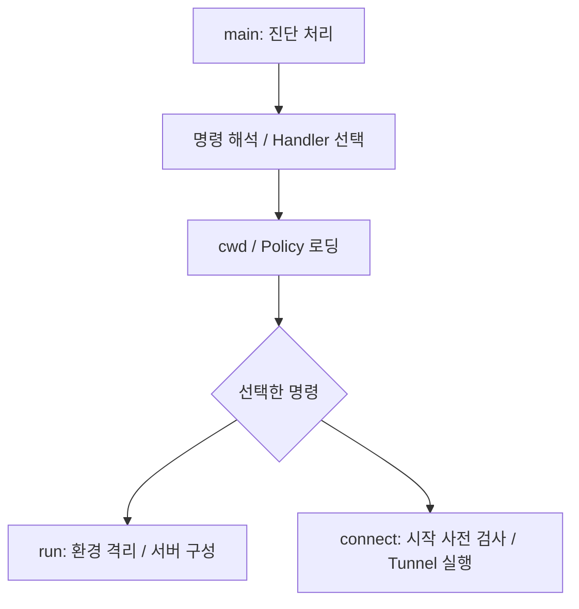

# 실행 흐름과 연결 원리

[개발 규약](conventions.md)이 배치·호출 경계의 유지 기준을,
[설정과 운영 계약](configuration.md)이 사용자 값·권한·시작·종료·진단·정리 보장을 소유한다.
이 문서는 여러 module이 연결되는 방식과 그 이유를 설명한다.

## CLI에서 서버로

[`cli.py`](../src/local_dev_mcp/cli.py)의 명령 선택은 설정 로딩보다 먼저다.
설정이 없는 디렉터리에서도 help와 사용 오류를 처리하기 위해서다.

`run`은 최소 환경으로 교체하고 FastMCP의 자동 dotenv 읽기를 끈 뒤 서버를 import한다.
라이브러리의 import 시점 로딩이 애플리케이션의 명시적 설정 읽기보다 먼저 실행되지 않게 하기 위해서다.
[`ServerSettings.load()`](../src/local_dev_mcp/runtime.py)는 시작 snapshot을 만들고,
[`create_server()`](../src/local_dev_mcp/core/server.py)는 수동 정의 목록과 서버별 실행 객체를 등록한다.
준비값과 안전한 준비 오류를 구분해 등록·터미널 경고·상태 조회·호출 거부가 같은 snapshot을 사용한다.
설정의 적용 시점과 시작 오류 조건은 [시작 snapshot](configuration.md#시작-snapshot)을 따른다.

## MCP에서 작업으로

호출 순서와 내부 조합의 규칙은 [공통 호출 경계](conventions.md#도구-정의와-호출-경계)에 있다.
[`registry.py`](../src/local_dev_mcp/tools/registry.py)의 권한 middleware를 통과하면
같은 middleware가 시작 snapshot의 도구별 준비 상태도 확인한다.
준비 부족이 입력과 무관한 고정 정보이므로 strict 검증·동적 GPG 준비 전에 거부할 수 있다.
그다음 FastMCP가 원본 인자의 strict 검증과 dependency 준비를 수행하고 본문을 호출한다.

commit의 연결 함수는 공개 message와 Depends 준비값을 받아 일반 Python 본문에 전달한다.
provider는 시작 설정을 다시 읽지 않고 필요한 동적 GPG 상태를 확인한다.
공백뿐인 메시지 등 본문에서 수행하는 의미 검증까지 dependency보다 먼저인 것은 아니다.
내부 Python 조합은 준비값을 명시적으로 전달하고 공통 Git 실행의 정책 검사도 거친다.

FastMCP는 schema·구조화 결과·transport를 처리하며 애플리케이션은 Policy·Git 의미·안전한 진단을 처리한다.
`SafeToolDiagnostics`는 검증 실패를 필드·오류 종류·수정 안내로 바꾸고 거부한 값이나 임의 필드명을 반복하지 않는다.
`safe_execution`은 예상하지 못한 provider·본문 예외가 SDK 원문 logger에 도달하기 전에 안전하게 변환한다.
응답 masking만으로는 SDK 내부 로그에 포함될 원래 예외를 제거할 수 없기 때문이다.
출력 형식과 도구 오류·CLI 종료의 구분은 [운영 진단 계약](configuration.md#진단-출력)을 따른다.

Git은 facade → 명령 함수 → 실행 지원으로 작업을 진행한다.
실제 경로·symlink·저장소 상태는 작업 계층에서 확인하며 schema 검증만으로 대신할 수 없다.
HEAD의 누적 시간 예산과 쓰기·후속 관측의 의미는 [Git 계약](tools/git/README.md)이 소유한다.

## Tunnel 연결

[`tools/tunnel_client`](../src/local_dev_mcp/tools/tunnel_client)의 실행 순서는 다음과 같다.

1. tunnel-client 권한·실행 파일과 프로젝트 .env의 Tunnel 값을 검증한다.
2. 별도 Python 프로세스의 `_preflight.py`로 MCP 정적 시작 설정을 검사한다.
3. 사전 검사의 안전한 실패·경고를 CLI 진단으로 변환한다. 전체 시작 실패만 client 실행을 막는다.
4. 성공하면 shellous로 `tunnel-client run`을 시작하고 현재 Python의 `-I -m local_dev_mcp run`과 initialized notification 옵션을 전달한다.
5. client가 같은 디렉터리에서 stdio 자식을 실행하고, 자식은 자기 시작 snapshot을 만든다.

사전 검사를 별도 프로세스에서 수행해 run과 같은 import 격리 상태에서 시작 설정을 검증한다.
검사와 실제 자식 실행은 서로 다른 시점에 이루어지므로 하나의 설정 snapshot을 공유하는 구조가 아니다.
사전 검사의 범위·제한과 readiness 해석은 [연결 상태 계약](configuration.md#연결-사전-검사와-상태-해석)을 따른다.

## 진단의 격리

[`diagnostics.py`](../src/local_dev_mcp/diagnostics.py)는 전용 logger에 호출별 handler를 연결하고 종료 시 제거한다.
logger 상태도 복원해 같은 프로세스의 다른 호출이나 root logger에 설정이 남지 않게 한다.
사용자에게 전달하는 종료 코드·진단은 [운영 계약](configuration.md#종료-코드)이 소유한다.

## 실행과 취소의 연결

비동기 Git/GPG·Tunnel·사전 검사 프로세스는 shellous가 실행·취소·대기를 맡는다.
동기 시작 로더의 짧은 gpgconf 조회는 subprocess.run의 timeout·종료 대기를 사용한다.
Git 실행은 shellous가 직접 프로세스를 정리한 뒤 억제한 취소를 다시 전달해 상위 시간 예산을 유지한다.

Tunnel의 `_TunnelRun`은 라이브러리 handle로 직접 종료 여부를 관찰한다.
반복 SIGINT가 코루틴의 취소 처리를 건너뛰더라도 이 handle을 확인해 정리 성공을 추정하지 않게 한다.
직접 프로세스와 공유 daemon의 구분·정리 보장 범위는 [프로세스 정리 계약](configuration.md#프로세스-정리-보장)을 따른다.
